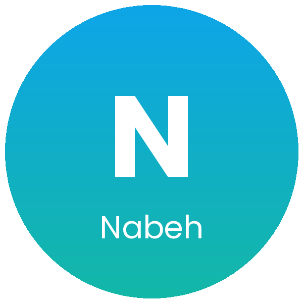

  

  

<h3 align="center">🛡️ Nabeh · Smart Safety System for Pilgrims</h3>

     

---

## 📌 Overview

Nabeh is a smart safety system designed to reduce violations in restricted pilgrimage areas. It monitors these areas in real time and raises alerts when an incident is detected, helping keep pilgrims safe and areas compliant.

---

## ❓ The Problem

Some pilgrimage areas are restricted for safety and organizational reasons. When people enter them without permission, it creates risks for the pilgrims themselves and makes the work of the organizing authorities harder.

## 💡 Our Solution

Nabeh watches restricted areas continuously and detects incidents as they happen. When a violation occurs, the alert system notifies the responsible teams so they can respond quickly, while smart tracking supports safety and compliance.

---

## ✨ Key Features

<table>
  <tr>
    <td width="25%" align="center" valign="top"><h2>📡</h2><b>Real-time monitoring</b> Continuously monitors restricted pilgrimage areas.</td>
    <td width="25%" align="center" valign="top"><h2>🚨</h2><b>Alert system</b> Raises alerts as soon as an incident is detected.</td>
    <td width="25%" align="center" valign="top"><h2>📍</h2><b>Smart tracking</b> Uses smart tracking solutions to support safety and compliance.</td>
    <td width="25%" align="center" valign="top"><h2>✅</h2><b>Fewer violations</b> Aims to reduce violations in restricted areas.</td>
  </tr>
</table>

---

## 🏆 Achievements

| | Achievement |
| :---: | --- |
| 🛡️ | **Enhanced safety and compliance through smart tracking solutions** |

---

## 🌍 Impact Areas

Public safety · Smart monitoring · Hajj and Umrah services

---

## 👩‍💻 Team

Built by **[Roz Alomar](https://github.com/RSA445)**, AI Solutions Builder and Information Systems student at Najran University.

  
  
  

  

